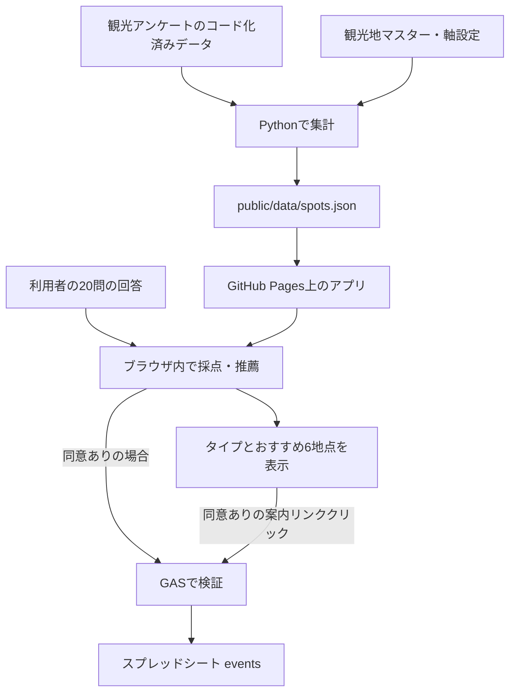

# とやま旅もよう — アプリケーション詳細仕様書

作成日：2026年11月5日  
対象：現行実装（アプリ・収集スキーマのバージョン `0.3.0`、名称変更反映コミット `a34e646`）  
想定読者：運営担当者、分析担当者、開発引き継ぎ先、企画内容を確認する第三者

本書は現在のソースコードと公開用データに基づく仕様をまとめたものです。初期企画から変更された内容は現行実装を優先し、未実装・検討中の内容は末尾に分けて記載しています。本書作成によるアプリやGASの機能変更はありません。

## 1. サービス概要

「とやま旅もよう」は、旅の好みに関する20問への回答から利用者を16タイプに分類し、富山県内のおすすめ観光地を紹介する日本語のWebアプリです。スマートフォンで気軽に遊べることを重視し、個人制作のアプリとしてnote等からの利用を想定しています。

推薦の材料は「富山県観光ウェブアンケートデータ」（CC BY 4.0）の集計結果と、観光地の特徴を表す事前スコアです。タイプ名やキャラクターは診断体験をわかりやすくするためのコンテンツです。名称自体を使って観光地を検索・選定する仕組みではありません。

- 公開サイト：<https://toyama-opendata.github.io/tourism_app/>
- リポジトリ：<https://github.com/toyama-opendata/tourism_app>
- 診断：20問、5問ずつ4ページ、目安3〜4分
- 結果：16タイプ、4軸の傾向、おすすめ3か所＋追加3か所
- 会員登録・ログイン：なし
- 診断料金：アプリ内に課金機能なし
- 回答収集：利用者が同意した場合のみ
- アクセス解析ツール：導入なし

本アプリは独自の旅の好み診断です。MBTIの公式検査や心理学的な性格評価ではありません。MBTIの文字の組み合わせは再現せず、独自の4軸を使用します。

## 2. システム構成

| 構成要素 | 技術・サービス | 役割 |
|---|---|---|
| フロントエンド | Vite、React、TypeScript | 画面表示、採点、観光地の推薦、同意管理、送信 |
| サイト配信 | GitHub Pages | ビルド済みの静的ファイルを公開 |
| 自動公開 | GitHub Actions | mainへのpushでテスト・ビルド・デプロイ |
| データ前処理 | Python、pandas、NumPy、openpyxl、PyYAML | アンケートの集計と公開JSONの生成 |
| 回答受付 | Google Apps Script（GAS） | POSTデータの検証、重複確認、シートへの追記 |
| 回答保存 | Googleスプレッドシート | 診断・リンククリックのイベントを蓄積 |
| OGP画像生成 | sharp | タイプごとのシェア画像をビルド時に生成 |

サイト自体は静的です。診断と推薦は利用者のブラウザ内で完結し、GASは収集専用として使用します。GASに接続できなくても診断結果を表示できます。実行時に生成AIや外部AI APIを呼び出す処理はありません。



蓄積した診断データから推薦スコアを自動更新する経路はありません。観光アンケートの更新と、アプリ利用者の回答収集は別の処理です。

## 3. 画面・利用フロー

### 3.1 トップページ

タイトル、診断の紹介、所要時間、開始ボタン、キャラクターを表示します。タイプ一覧、おすすめの仕組み、データの取り扱いへ移動できます。デザインは白背景を基本とし、丸い旅の窓とキャラクターを使用します。

### 3.2 質問画面

- 1ページ5問、全4ページです。各ページは1つの軸に対応します。
- 5段階の選択肢は左から否定→肯定の順です。
- ページ内の5問すべてに回答すると次へ進めます。
- 回答済みの問数を進捗バーと数値で表示します。
- 前のページに戻って回答を変更できます。
- 回答はReactのメモリ上に保持します。途中回答の永続保存・途中再開機能はなく、再読み込みすると初めからになります。

### 3.3 任意属性・同意画面

年代、居住都道府県、同行者、富山への訪問経験を任意で入力できます。これらは比較分析のための項目であり、タイプ判定や推薦順位には使いません。

同意チェックは初期状態でオフです。同意しなくても結果を表示します。「属性入力をスキップして結果を見る」を押した場合は、入力済みであっても属性をすべて未回答として扱います。属性スキップと送信同意は独立しており、同意にチェックしていれば属性なしの診断を送信します。

### 3.4 診断結果画面

- タイプ記号、タイプ名、固有のキャラクター画像
- タイプの説明文、強み・旅の傾向、旅のヒント
- 4軸の横棒と位置マーカー
- 個人の連続スコアに基づくおすすめ3か所
- 同じタイプの代表スコアに基づく追加3か所
- 2026年11月8日変更：初期表示は主3件。「ほかの候補も見る」で追加3件を展開し、同じボタンで閉じる。再診断時は閉じる。タイプ紹介ページも同様。
- 観光地の写真、名称、市町村、説明、データ由来の理由、案内リンク
- Xシェア、タイプ紹介URLのコピー、再診断、タイプ一覧への導線
- 回答送信の状態、失敗時の再試行、以後のクリック送信を停止する操作

横棒は左端が正側、右端が負側です。位置は `(1 - 軸スコア) × 50%` で決まります。0の場合は中央に置き、「どちらも同じくらい」と表示します。適合率・確率の百分率は表示しません。

### 3.5 タイプ一覧・タイプ紹介ページ

`/types/` に16タイプの一覧、`/types/nagm/` 等に各タイプの紹介ページがあります。パスはサイトのベースパス `/tourism_app/` からの相対表記です。

個人の結果画面と異なり、タイプ紹介ページは代表ベクトルで推薦を計算します。個別回答・属性・個人のスコアはURLに含めません。シェア先はこの紹介ページであるため、元の診断結果とおすすめが完全に同じになるとは限りません。

### 3.6 おすすめの仕組み・データの取り扱い

`/about/` は、アンケートを手がかりにおすすめを表示する流れを3ステップで短く説明します。各ステップ専用のイラストを使用します。

データの取り扱い画面では収集内容・同意等を説明します。`#privacy` で初期表示する仕組みがあります。データ出典はアンケート名とCC BY 4.0を用いて表記しています。

## 4. 診断の4軸と採点

| 軸 | 正側（左） | 負側（右） | 対応質問 |
|---|---|---|---|
| 1 | N：自然派 | C：街・文化派 | q1〜q5 |
| 2 | A：アクティブ | R：のんびり | q6〜q10 |
| 3 | G：グルメ・買い物 | E：体験・交流 | q11〜q15 |
| 4 | M：定番 | H：穴場 | q16〜q20 |

EはExperienceの意味です。N・EはMBTIでの意味とは無関係です。

### 4.1 回答値

| 保存値 | 選択肢 |
|---|---|
| 1 | まったくそう思わない |
| 2 | あまりそう思わない |
| 3 | どちらともいえない |
| 4 | ややそう思う |
| 5 | とてもそう思う |

各回答を `(回答値 - 3) / 2` により−1〜+1へ変換します。逆転項目はさらに−1を掛け、各軸5問の平均を軸スコアにします。各軸の最初の3問は通常項目、最後の2問は逆転項目です。

```text
軸スコア = Σ [ ((回答値 - 3) / 2) × direction ] / 5
direction：通常項目は +1、逆転項目は -1
```

推薦にはこの数値をそのまま使い、タイプは各軸の符号で決めます。0以上なら左側、0未満なら右側です。すべて中立の場合、スコアは `[0,0,0,0]`、記号は `NAGM` になります。現行20問・5段階では軸スコアは0.1刻みの値を取ります。

### 4.2 全20問

| ID | 質問 | 逆転 |
|---|---|---|
| q1 | 旅先では、山や海などの広い景色を眺めたい。 | — |
| q2 | 街の中心部より、自然に囲まれた場所に心がひかれる。 | — |
| q3 | 季節の花や木々の変化を楽しむ時間をつくりたい。 | — |
| q4 | 建築や美術、その土地の歴史を知ることが旅の楽しみだ。 | ○ |
| q5 | その土地の暮らしが感じられる街並みや建物を、じっくり見て回りたい。 | ○ |
| q6 | 旅先では、歩いたり体を動かしたりして過ごしたい。 | — |
| q7 | 少し移動に手間がかかっても、見たい場所には出かけたい。 | — |
| q8 | 旅の一日には、いくつかの楽しみを組み込みたい。 | — |
| q9 | 予定を詰めず、一つの場所でゆっくり過ごす旅が好きだ。 | ○ |
| q10 | 旅先では、何もしないでくつろぐ時間も大切にしたい。 | ○ |
| q11 | その土地ならではの料理を食べることは、旅の大きな目的だ。 | — |
| q12 | 市場やお店を巡って、気に入った品を探すのが好きだ。 | — |
| q13 | 旅を振り返ると、おいしかったものや買ったものをよく思い出す。 | — |
| q14 | 食事や買い物よりも、ものづくりや地元の人との交流に時間を使いたい。 | ○ |
| q15 | 旅のおみやげを選ぶより、その土地ならではの体験に参加したい。 | ○ |
| q16 | 初めて行く地域では、まず代表的な名所を訪ねたい。 | — |
| q17 | 多くの人がすすめる場所は、自分でも体験してみたい。 | — |
| q18 | 旅の行き先を決めるとき、よく知られた場所を候補にする。 | — |
| q19 | 知名度が低くても、自分だけのお気に入りになりそうな場所を探したい。 | ○ |
| q20 | 定番コースから少し外れて、あまり紹介されていない場所にも立ち寄りたい。 | ○ |

### 4.3 現行16タイプ

| 記号 | 名称 | 記号 | 名称 |
|---|---|---|---|
| NAGM | 自然の美食家 | CAGM | まちなかの美食家 |
| NAGH | 味覚の探検家 | CAGH | 街の目利き |
| NAEM | 自然の冒険家 | CAEM | 越中の文化探訪家 |
| NAEH | 自然の発見家 | CAEH | 文化の発見家 |
| NRGM | 景色のごちそう人 | CRGM | 街角のくつろぎ人 |
| NRGH | ゆったり味わい人 | CRGH | 街の収集家 |
| NREM | 自然の観察家 | CREM | 越中の物語びと |
| NREH | 自然の聞き手 | CREH | 文化の聞き書き人 |

タイプ名・説明・強み・旅のヒントは `src/content/types.ts` に集約しています。2026年11月5日に11タイプの名称を変更しました。記号・採点・推薦ロジック・収集スキーマはこの変更では変えていません。

## 5. 観光アンケートデータ

### 5.1 採用データと現在の集計規模

当初指定の生CSVに代えて、既存の観光地おすすめアプリで使用したコード化済みデータセットとコードブックを採用しています。

- データセット：`opendata_dataset_merge_202608.xlsx`
- コードブック：`コーディングルール_データセット定義書.xlsx`
- 現在の公開JSONに記録された対象期間：2025年4月28日〜2026年8月31日
- 集計対象回答数：11,188件
- 観光地数：47地点

数値は本書作成時点の `public/data/spots.json` に基づきます。回答件数であり、重複のない実人数を意味しません。

入力の訪問目的・訪問先は、選択肢別の列に0/1が入る形式です。1回答が複数地点に該当するため、地点別nを合計しても全回答数には一致しません。訪問先には訪問予定も含まれます。

CSV入力ではUTF-8 BOM対応、CP932、Shift_JISの順に厳密なデコードを試します。任意の文字コードを推測する方式ではなく、この3候補を順に確認します。公開JSONはUTF-8です。

### 5.2 集計対象の条件

1. 訪問目的が「出張など仕事関係」だけの回答を除外します。他の目的も選んだ回答はこの理由では除外しません。
2. 富山県在住者を除外します。居住地が富山県、または居住エリアコード99を県内扱いとします。
3. 居住地が47都道府県のいずれにも該当しない回答を除外します。
4. 日付が不正、目的・訪問先フラグが0/1以外、必要な列がない場合は処理を停止します。

この県外限定は推薦用の元アンケート集計に対する条件です。アプリ利用者の回答収集は県内在住者も対象です。

### 5.3 設問改訂への対応

訪問場所は2026年4月1日の改訂で旧21地点に26地点が追加され、47地点を扱います。`data/master/spots_master.csv` の統一ID、対応する元列、選択肢の存在開始日・終了日を使います。

各地点の分母は、その地点が選択肢に存在した期間の集計対象回答です。新設地点について改訂前の回答を分母に入れません。目的の基準選択率やNPSの比較対象も同じ対象期間にそろえます。開始日前の選択記録は監査用件数に残し、当該地点の有効訪問数には含めません。

### 5.4 評価指標の意味

満足度・推奨度（NPS）・再訪意向は、観光地単体ではなく旅行全体に対する回答です。「その地点を選んだ人の旅行全体の評価」として扱います。満足度・再訪意向の上位2段階割合は確認用集計に含めますが、現行の推薦順位に直接使っていません。

## 6. 観光地の4軸スコア

### 6.1 訪問目的と軸1〜3の対応

各グループ内のいずれか1つ以上の目的を選択した回答を、そのグループの選択者として数えます。同じ回答が左右両方のグループに該当することもあります。

| 記号 | 対応する目的 |
|---|---|
| N | 自然鑑賞／アウトドア／クルーズ・観光船 |
| C | 名所・旧跡・寺社仏閣／文化施設の見学・体験 |
| A | スキー・スノボ・マリンスポーツ／その他スポーツ／ドライブ・ツーリング／自己成長のための新しい体験 |
| R | 宿でのんびり／温泉・露天風呂／健康増進 |
| G | 地元の食／工芸品・特産品等の買い物／アウトレット等の買い物 |
| E | 工場見学・体験／祭り・イベント／地域の人との交流・生活文化体験 |

採用データでは「まちあるき、都市散策各種体験（手作り、果物狩りなど）」が結合された選択肢になっています。CとEを区別できないため、ユーザー確認に基づき両グループから除外しています。初期企画にあった独立したまちあるき・各種体験の割り当てとは異なります。完全な元ラベルは `config/axis_mapping.yaml` に記録しています。

### 6.2 軸1〜3：目的選択率のリフト

地点ごとに次を計算します。

```text
n：その地点の有効な訪問・訪問予定回答数
T：その地点の選択肢が存在した期間の対象回答数
cL, cR：その地点の回答者のうち、左・右の目的グループを選んだ件数
bL, bR：同期間の全対象回答のうち、左・右を選んだ件数
α = 0.5

liftL = ((cL + α) / (n + 2α)) / ((bL + α) / (T + 2α))
liftR = ((cR + α) / (n + 2α)) / ((bR + α) / (T + 2α))
raw = log(liftL) - log(liftR)
```

0件による不安定さを抑えるためαを加えます。軸ごとに地点間でrawをzスコア化（標準偏差はddof=0）し、−2〜+2に収めます。これは訪問者の旅全体の目的傾向であり、その地点で実際に体験可能な内容を直接表すものではありません。

### 6.3 事前スコアとの混合

地点マスターには各軸の事前スコア `prior_axis1`〜`prior_axis4`（−2〜+2）があります。一般的な特徴から作成した初期案で、根拠をnotesに持ちます。

```text
final = (n × data_score + k × prior_score) / (n + k)
k = 30
```

件数が少ないほど事前スコアの影響が大きくなります。n=0またはデータスコアが欠損の場合、軸1〜3は事前スコアを使用します。事前スコア全件の現場確認は完了していません。kは設定ファイルから変更可能です。

### 6.4 軸4：定番・穴場

推奨度0〜10の整数を有効値とし、NPSを次で計算します。

```text
NPS = 100 × (9〜10点の割合 - 0〜6点の割合)
ΔNPS = 地点選択者の旅行全体NPS - 同期間の対象回答全体NPS
訪問率 r = n / T
```

穴場側の負スコアを許可する条件は、次のすべてを満たすことです。

- 訪問率が5%未満
- 地点の回答数nが30以上
- ΔNPSが算出でき、0より大きい
- 事前M/Hスコアが定番保護の対象ではない

```text
popularity = clip(r / 0.05 - 1, 0, 2)

穴場条件を満たす場合：
  rarity = 1 - r / 0.05
  advantage = min(ΔNPS / 20, 1)
  data_score = -2 × min(rarity, advantage)

満たさない場合：
  data_score = popularity
```

算出後にk=30で事前スコアと混合します。穴場条件を満たさない地点は、混合後も0未満にしません。n=0等では非負の事前値を使用します。

事前M/Hスコアが+1以上の地点は、知名度の高い場所を穴場にしないための定番保護を優先し、`max(popularity, prior)` をデータスコアにします。称名滝はユーザーの現場知見に基づき、この保護対象となるprior=1.0に変更済みです。閾値は学習された確率ではなく、編集上の設定です。

### 6.5 データに基づくおすすめ理由

2026年11月5日に理由選定を変更しました。軸に採用した個別目的から、地点回答30件以上・目的回答10件以上・選択率10%以上・同期間の全体より5ポイント以上高い・全体の1.2倍以上という条件を満たす候補を選びます。条件は `config/reason_review.yaml` に保存しています。

- 自動選択は `(地点選択率－全体選択率) × n/(n+30)` が最大の候補を採用します。同じ地点では補正係数が共通のため、順位は未補正の差と同じです。
- ユーザー指定11地点は `config/reason_overrides.yaml` の目的を優先します。入善の食事目的は倍率条件未達ですが指定として採用し、実測値を表示します。最低件数・選択率は指定でも満たす必要があります。
- 文は「この場所を選んだ人の○%が、旅の目的に『目的名』を挙げています（同期間の全体では○%）。」とします。
- 候補がない場合は公開データの生成を停止します。非表示・紹介文への置換は未決定のため、自動では行いません。
- 目的は旅行全体の回答です。その場所で行った活動と読み替えません。

変更前は単純な選択件数の最大値を採用していたため、47地点すべて食事目的になっていました。理由文は表示専用で、推薦順位の計算には使われません。修正版の全47地点の文章は `docs/reason-review/revised.md` に記録しています。

## 7. おすすめ観光地の選定

### 7.1 主の3か所

利用者の4軸スコアu（−1〜+1）と、地点のスコアs（−2〜+2）の重み付き内積を使います。

```text
基本点 = Σ [ u[i] × (s[i] / 2) × weight[i] ]
weight = [1, 1, 1, 1]

選定時点の点数 = 基本点 - 0.35 × 既に選んだ同一市町村の地点数
```

最高点の地点を1つずつ選び、3件になるまで繰り返す貪欲法です。同点の場合は地点IDの昇順を優先します。市町村ペナルティは同一市町村を禁止するものではなく、偏りを和らげるものです。

コサイン類似度や距離ではありません。ベクトルの長さで正規化しないため、同じ方向ではスコアの絶対値が大きい地点が有利になる性質があります。全軸0の場合は基本点がすべて同点になり、ID順と市町村ペナルティで主3件を選びます。

### 7.2 追加の3か所

タイプ記号を各軸+1または−1へ変換した代表ベクトルを使います。例えばNREMなら `[+1,-1,-1,+1]` です。

主3件を候補から除外し、同じ方法で追加3件を選びます。追加側の市町村ペナルティは追加側で既に選んだ地点だけを数えます。主3件と追加3件を通じた市町村の完全な分散は保証しません。

追加3件は主3件の除外後に計算するため、同じタイプでも利用者の主3件が異なれば変わる場合があります。

### 7.3 選定に使用しない情報

年代、居住都道府県、同行者、訪問経験、GPS、現在地、天気、営業時間、交通手段、予算、混雑、季節、予約可否は推薦順位に使いません。タイプ名に含まれる語やキャラクターも使いません。海・川・山・ものづくり可否などの意味的な条件で必須絞り込みする処理はありません。

## 8. 公開用データの形式

`public/data/spots.json` のトップレベルには次を保存します。

| 項目 | 内容 |
|---|---|
| schemaVersion | JSON構造の版。現在1 |
| period | 対象開始日・終了日の配列 |
| responses | 除外処理後の対象回答数 |
| audience | 集計対象の説明 |
| spots | 地点の配列 |

各地点は `id`、`name`、`municipality`、`scores`（4軸）、`n`、`reason`、`description`、`url` を持ちます。スコアは小数点以下6桁で出力します。地点IDは `tym001`〜`tym047` です。

個票、自由記述、個人の属性行はこのJSONへ出力しません。公開用フィールドを限定して生成します。回答収集先のスプレッドシートも公開アセットには含めません。

## 9. 回答収集・GAS

### 9.1 送信条件と通信

- `VITE_GAS_ENDPOINT` が設定され、利用者が同意した場合だけ送信します。
- 同意なしでも診断・推薦は通常どおり動きます。
- 再診断時は同意をオフに戻します。
- POSTの本文はJSON文字列、Content-Typeは `text/plain;charset=UTF-8` です。
- `fetch` は `mode: no-cors`、`credentials: omit`、`keepalive: true` を使用します。
- 8秒で待機を打ち切ります。ただし既にサーバーに届いた処理が保存されることはあります。
- ブラウザは応答内容を読めないため、保存成功ではなく「送信をリクエスト」と表示します。
- 通信失敗を検知した診断は、画面から同じイベントIDで手動再送できます。
- 未送信イベントの永続キュー、自動再送、クリック失敗の再送UIはありません。

### 9.2 イベント種別

| event_type | タイミング | 内容 |
|---|---|---|
| diagnosis | 同意して診断結果を表示したとき | 1回の診断を1行保存 |
| spot_click | その診断結果の観光地案内リンクを押したとき | クリックを1行保存 |

トップ閲覧、途中回答、離脱、Xシェア、タイプ紹介ページの閲覧・案内リンククリックは収集しません。1診断で2回リンクを押すと合計3行です。同じリンクを2回押した場合は2回のクリックとして記録します。クリックは外部サイトへのリンク操作であり、外部ページの読了・予約・実来訪は検知しません。

クリック行にも元診断の回答・属性・表示地点を付けます。以後のクリック送信を止める操作がありますが、既に送信済み・送信処理中のデータは取り消しません。

### 9.3 保存列（eventsシート）

2026年11月8日の折りたたみ表示導入後も、recommended_spot_idsには選定した6地点を保存します。追加3件を実際に開いたことを示す記録ではありません。展開・折りたたみのイベントは収集していません。

| 列 | 型・内容 |
|---|---|
| received_at | GASの受付時刻。UTCのISO文字列 |
| timestamp | 端末側の操作時刻。UTCのISO文字列 |
| event_id | 送信イベントのUUID v4。重複判定に使用 |
| result_id | 診断単位のUUID v4。診断とクリックを関連付ける |
| event_type | diagnosis / spot_click |
| session_id | 同じブラウザを関連付けるUUID v4 |
| app_version | 現在0.3.0 |
| consent | true。falseのデータは受け付けない |
| q1〜q20 | 回答値1〜5。逆転処理前の値 |
| axis1〜axis4 | 回答から計算した4軸スコア |
| type | NAGM等の4文字。日本語タイプ名は保存しない |
| age | 年代コード。未回答は空欄 |
| prefecture | 都道府県名。未回答は空欄 |
| companion | 同行者コード。未回答は空欄 |
| experience | 富山への訪問経験。未回答は空欄 |
| recommended_spot_ids | 主3件→追加3件の順のIDを `|` 区切りで保存 |
| clicked_spot_id | クリックした地点ID。診断行は空欄 |

JSONでは回答は `answers` オブジェクト、軸は `axis_scores` 配列、属性は `attributes` オブジェクトで送信します。GASがこれらを列に展開し、nullを空欄へ変換します。

### 9.4 任意属性のコード

- 年代：0＝10歳未満、10＝10代、20＝20代、30＝30代、40＝40代、50＝50代、60＝60代、70＝70代、80＝80歳以上。
- 居住都道府県：47都道府県の名称。海外・その他の選択肢はありません。
- 訪問経験：「なし」「1回」「2回以上」「県内在住」。

| 同行者コード | 内容 |
|---|---|
| 0 | その他 |
| 1 | 子供連れ家族（一番下のお子様が未就学児） |
| 2 | 子供連れ家族（一番下のお子様が小学生～高校生） |
| 3 | 大人の家族（18歳以上の子供含む） |
| 4 | 夫婦 |
| 5 | カップル |
| 6 | 友人・知人 |
| 7 | 職場や学校の仲間（団体旅行・ツアー） |
| 8 | ひとり |

0は未回答ではありません。年代と同行者の分析時に、空欄と0を区別します。

### 9.5 ID・重複・同一利用者の扱い

`session_id` はlocalStorageの `toyama-tabitype-session-v1` に保存します。有効期限を設けておらず、同じブラウザの保存情報が残っていれば翌日以降も同じIDです。名称はsessionですが、訪問ごとに切り替わるIDではありません。保存不可の場合はページ内のメモリに保持します。

別端末・別ブラウザ・保存情報削除等では別IDになり得るため、厳密な実人数の識別には使えません。再診断は新しいresult_idで保存します。

診断イベントはevent_id=result_idです。クリックには新しいevent_idと元のresult_idを付けます。GASは排他ロック内でevent_id列を検索し、同一IDなら追加を行わず重複受理を返します。診断行の受信が失敗してクリック行だけが届く可能性はあり、クリックに対応する診断行の存在はGASで必須検証していません。

### 9.6 GASの検証

本文の長さは20,000文字以内、JSONオブジェクトであることを確認します。さらに次を検証します。

- 同意true、UUID形式、イベント種別、タイムスタンプ形式
- app_versionが0.3.0と完全一致
- 回答が20項目、各値が1〜5の整数
- 回答から4軸を再計算し、送られたスコアと誤差1e-9未満で一致
- スコアから算出したタイプ記号との一致
- 属性4項目の存在、許容された選択肢・コード
- おすすめIDが6件、重複なし、tym001〜tym047の範囲
- クリック地点が表示した6件に含まれること
- eventsのヘッダーがコードで定義した列順・列名と一致すること

GASは推薦順位の再計算まではしません。整合した形式の投稿が正規画面から送信されたことを保証する認証もありません。氏名、メール、IP、User-Agent、自由記述を保存する列・処理はありません。

### 9.7 設定と変更時の注意

スクリプトプロパティの `SPREADSHEET_ID` で保存先を指定します。`setup()` はeventsを作成し、ヘッダーを設定します。以後はPOSTごとに自動で動くため、管理者が毎回実行する必要はありません。

GASは実行ユーザー「自分」、アクセス「全員」のWebアプリとして公開する構成です。シート自体は一般公開しません。受付URLはフロントの公開JavaScriptに含まれますが、シートIDやGoogleの認証情報はフロントに置きません。

GASコード変更時は既存デプロイを新しいバージョンに更新する必要があります。GitHubへのpushだけではGASのコードは更新されません。

## 10. データ蓄積後の運用・分析

### 10.1 日常運用

eventsを原本として維持し、集計は別シートやCSVの複製で行います。列名・列順・シート名を変えると受付が失敗するため、収集中の原本は加工しません。必要に応じてバックアップします。受付はGoogle側で動くため管理者のPC起動は不要です。

公開・更新直後は、同意なしで増えないこと、同意ありでdiagnosisが増えること、リンク操作でspot_clickが増えることを実際のブラウザとシートで確認します。GASへの直接送信による受付・重複拒否の確認と、ブラウザを通した一連の動作確認は区別します。

### 10.2 集計単位

| 知りたいこと | 集計方法 |
|---|---|
| 保存された診断件数 | event_type=diagnosisの行数、またはそのresult_idのユニーク数 |
| ブラウザ単位の利用規模 | diagnosis内のsession_idのユニーク数 |
| タイプ構成 | diagnosisだけに絞ってtype別集計 |
| 属性ごとの傾向 | diagnosisだけに絞り、年代等とtype・軸を集計 |
| 地点へのリンククリック数 | spot_clickをclicked_spot_id別に集計 |
| 地点をクリックした診断の数 | result_idとclicked_spot_idの組を重複除去 |
| 表示に対するクリックの傾向 | 診断行の表示IDを展開し、関連するクリックと比較 |

クリック行にも回答が含まれるため、全行の回答をそのまま集計すると、クリックの多い診断を重複して数えてしまいます。クリック率を出す場合は「総クリック数」か「1診断1地点につき1回」かを先に決めます。

表示IDは選定された地点の記録であり、そのカードまで実際にスクロールして閲覧したことは意味しません。ページ全体の訪問数や同意しなかった診断数は収集していないため、アクセス数に対する完了率・同意率は現行データだけでは算出できません。

### 10.3 時刻・品質・保存期間

時刻はUTCです。日本時間にする場合は9時間加えます。端末時計に依存するtimestampと、GAS側のreceived_atを区別します。検証用の回答は本番分析から除外します。

通信失敗を含む全イベントの完全保存を保証する仕組みではありません。大量アクセス時の処理遅延や受付停止について自動監視・通知は実装していません。GASはイベントごとに既存ID列を検索するため、蓄積量が増えた際は動作時間を確認します。

自動削除・自動アーカイブ・定期バックアップはありません。保存期間、管理者、問い合わせ先、分析結果の公開範囲は運営上の取り決めとして管理します。

## 11. 画像・コンテンツ・静的ページ

タイプ画像は `public/images/types/{小文字のタイプ記号}.png` です。16タイプに異なるキャラクターを使用します。PNGが読み込めない場合のSVGフォールバックを持ちます。

観光地写真は次の順で読み込みます。

1. `public/images/spots/{spot_id}.jpg`
2. `src/content/spotPhotos.json` に対応する既存転用写真
3. `public/images/spot-placeholder.svg`

転用写真に紐づくクレジットはカードに表示します。独自写真への差し替え時は、その写真に合うクレジット設定になっているかも確認します。説明ページの画像は `public/images/about/step-1.png`〜`step-3.png` です。

`scripts/generate-pages.ts` が16タイプのHTMLと1200×630pxのPNG OGPを生成します。タイプ一覧、トップ、説明ページ、404ページも出力します。OGPにはタイプ名・記号・キャラクター等を使います。JavaScriptが動作する前にもタイプ紹介の基本HTMLがありますが、診断の操作にはJavaScriptが必要です。

## 12. ファイル構成と変更箇所

| パス | 役割 |
|---|---|
| src/App.tsx | 画面遷移、結果表示、同意、送信呼び出し |
| src/style.css | 画面デザイン、レスポンシブ表示 |
| src/content/questions.ts | 4軸、質問文、逆転指定、選択肢 |
| src/content/types.ts | 16タイプ名、説明、強み、ヒント |
| src/content/attributes.json | 任意属性の選択肢とコード |
| src/lib/diagnosis.ts | 採点、タイプ判定、推薦 |
| src/lib/collection.ts | ID、送信形式、通信処理、版番号 |
| src/components/AboutRecommendations.tsx | おすすめの仕組みの説明 |
| data/raw/ | 月次の入力データ。Git管理対象外 |
| data/master/spots_master.csv | 地点ID、対応列、期間、事前スコア等 |
| data/master/spot_details.json | 地点の説明 |
| config/axis_mapping.yaml | 目的と軸の対応、集計パラメーター |
| scripts/build_data.py | 集計の実行入口 |
| scripts/scoring.py | NPS、リフト、縮小、穴場条件 |
| scripts/export_public.py | 公開項目を限定したJSON出力 |
| public/data/spots.json | サイトが読み込む集計結果 |
| gas/Code.gs | GAS受付・検証・保存 |
| docs/gas_setup.md | GAS設定手順 |
| scripts/generate-pages.ts | 静的HTML・OGP生成 |
| scripts/verify-dist.ts | ビルド成果物の検証 |
| .github/workflows/pages.yml | GitHub Pagesへの自動公開 |
| tests/ | TypeScript、UI、Pythonのテスト |
| AGENTS.md | 開発方針と決定履歴 |

本表のパスはリポジトリルート基準です。生データ、環境変数ファイル、元画像の制作資料、ローカル集計監査資料は公開用ファイルと分離しています。

## 13. 実行・更新・公開手順

### 13.1 ローカル実行

READMEで案内するNode.jsは22.12以降、GitHub ActionsではNode.js 22を使用します。

```sh
npm ci
npm run dev
```

GAS送信も試す場合は `.env.local` に `VITE_GAS_ENDPOINT` を設定して起動し直します。設定しなければ送信をスキップします。実データ用の受付先へ接続したローカルテストも保存対象になるので、分析時に検証データを区別します。

### 13.2 月次データ更新

```sh
python -m pip install -r requirements.txt
python scripts/build_data.py
python -m pytest -q
```

通常は `data/raw/kanko_data.csv` を差し替えます。採用データセットと同じコード化済み列構成が必要です。CSVがない場合は、既存の相対配置にある `../dataset/出力データ/opendata_dataset_merge_202608.xlsx` を既定入力として使います。第三者環境では明示的な入力指定が確実です。

```sh
python scripts/build_data.py --input path/to/coded_dataset.xlsx
# CSVも指定可能
python scripts/build_data.py --input path/to/coded_dataset.csv
```

出力は `public/data/spots.json` と `docs/phase1/` の監査・確認用集計です。公開JSONの期間・件数・地点・スコアを確認し、必要な公開用ファイルをコミットします。通常更新で `draft_master.py` を実行して手修正済みマスターを再生成しないでください。

### 13.3 フロントの検証と公開

```sh
npm test
npm run test:ui
npm run build
npm run verify:dist
npm run preview
```

mainへのpush、またはGitHub Actionsの手動実行で次が動きます。

1. 依存関係とOGP用日本語フォントを準備
2. ロジック・GASテスト、UIテスト
3. TypeScript検証、Viteビルド、静的ページ・画像生成
4. 成果物検証
5. distをGitHub Pagesへデプロイ

ActionsはPages設定から `BASE_PATH` と `SITE_URL` を取得します。収集先はリポジトリ変数 `VITE_GAS_ENDPOINT` からビルド時に組み込みます。変数を変えた場合も再ビルド・公開が必要です。

Python集計・pytestはこのActionsには含まれません。元データ更新時に別途実行します。

### 13.4 変更ごとの影響範囲

| 変更 | フロントの再公開 | GAS対応 |
|---|---|---|
| タイプ名・説明・画像・一般文言 | 必要 | 通常不要 |
| 同じIDの観光地集計値・説明 | 必要 | 通常不要 |
| 推薦計算だけの変更 | 必要 | 送信形式が同じなら原則不要。ただし分析用版管理を検討 |
| 問数・並び・逆転・得点計算 | 必要 | 検証式を同期 |
| 属性の選択肢・コード | 必要 | 許容値を同期 |
| 地点ID範囲・表示件数 | 必要 | ID範囲・件数検証を同期 |
| app_version | 必要 | GASは完全一致のため同期が必要 |
| シート列構造 | 必要に応じて | ヘッダーと既存データの移行対応が必要 |

既存回答の列ずれを防ぐため、列構造を変える場合は旧シートを保管して新しい収集シートへ切り替える等の移行を行います。旧16問版と現行20問版では質問番号の意味が異なるため、同じq番号として単純合算しません。

## 14. 検証の範囲

- `npm test`：採点・推薦等のロジック、GAS入力検証等。
- `npm run test:ui`：DOM上の画面操作・遷移。
- `npm run build`：型検証、フロント・静的ページ・OGP生成。
- `npm run verify:dist`：生成HTML・画像等の配信成果物。
- `python -m pytest`：集計分母、複数回答、NPS、縮小推定等。

これらの成功と、公開ブラウザからGoogleスプレッドシートまでの実保存確認は別です。GASの設定変更後は実保存も確認します。ローカルの検証・比較スクリプトが存在していても、それだけで本番ロジックへ適用されたことにはなりません。

## 15. 既知の課題と未適用の改善案

2026年11月5日時点で次を区別します。

| 内容 | 現在の状態 |
|---|---|
| 20問・5問×4ページ | 実装済み |
| 県外在住者を元にした推薦データ | 適用済み |
| 定番保護を含む穴場条件、称名滝の定番扱い | 適用済み |
| 11タイプの名称と関連説明の見直し | 公開反映済み |
| GASによる20問版の受付 | 設定済み。運用時は実保存を確認 |
| 内積から距離方式への推薦変更 | 比較検討中、本番未適用 |
| 事前特徴の比重を増やす・少数回答を補正する案 | 比較検討中、本番未適用 |
| アウトレットを推薦候補から除外 | ユーザー要望・比較案あり。本番未適用 |
| 全地点の事前スコア・体験可能内容の現場レビュー | 未完了 |
| 47地点すべてが食事目的になる理由文の改善 | 全体との差・件数等の条件と、ユーザー指定11地点を反映したJSON・月次生成処理へ変更済み |

理由文の比較結果は `docs/reason-review/comparison.md` にまとめています。条件を満たさない地点の非表示・紹介文への置換は、比較結果を見て判断する方針です。今回の比較では該当地点がなく、将来の扱いは保留しています。

現行推薦には、出現しにくい地点があること、少数回答の地点が目立つこと、訪問者の旅行目的と地点の実際の特徴が一致しない場合があることが確認されています。名称を広げる対応は期待とのずれを減らしますが、地点選定そのものを修正するものではありません。

今後の推薦変更では、現場の知見との整合性、回答数の影響、地点の出現傾向、市町村の偏りを確認します。変更前後の収集データを比較できるよう版の記録も検討します。現行の保存項目には、独立した推薦ロジック版・元データ版・名称版はありません。

## 16. 第三者向けの説明例

> 「とやま旅もよう」は、旅の好みを20問で診断し、16タイプと富山のおすすめ観光地を紹介するWebアプリです。自然と街、アクティブとのんびりなど4つの軸で好みを数値化し、観光アンケートから作った各地点の特徴と照らし合わせます。結果はおすすめ3か所と追加3か所を表示します。診断はブラウザ内で動き、同意した利用者の回答と観光地リンクのクリックだけをGoogleスプレッドシートに蓄積します。蓄積データは後から分析するためのもので、おすすめが自動学習で変化する仕組みではありません。
